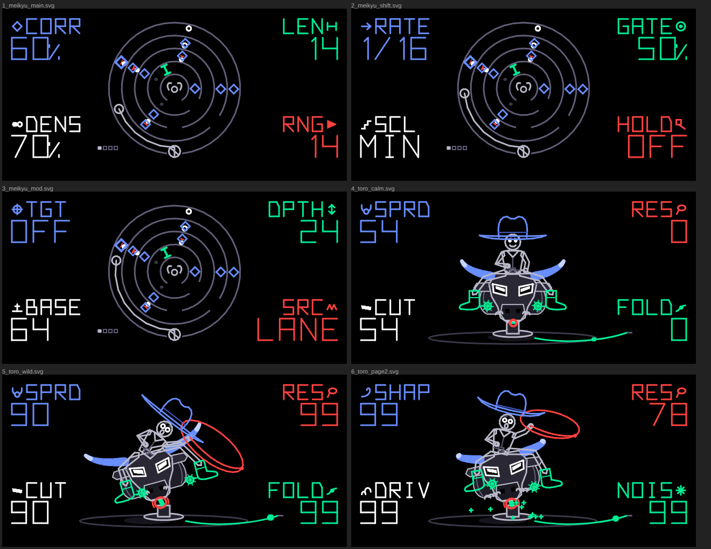
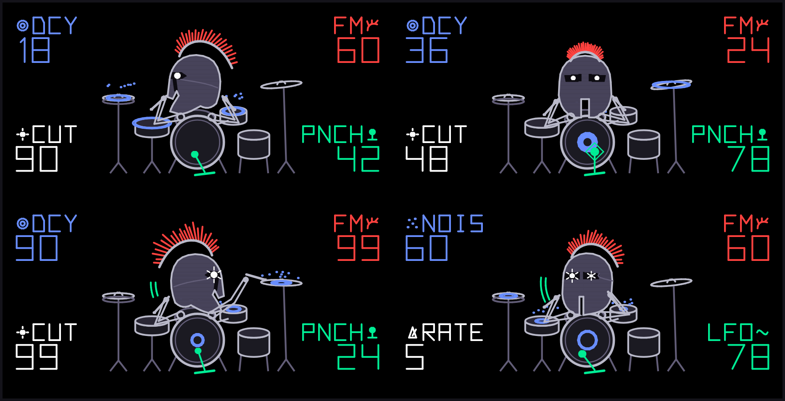
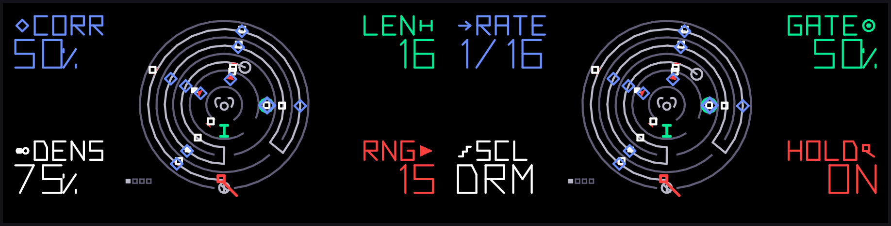
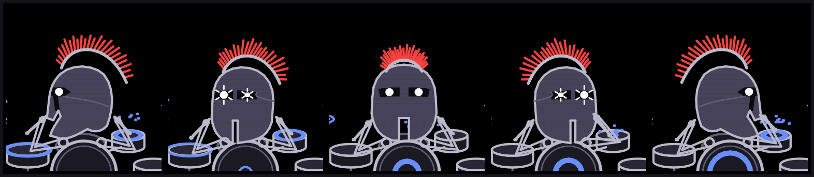

# meikyu + toro + theseus

Three OP-1 kennel plugins for Hundekraft 3.0.3 that I built as a set, loosely after the Moog Labyrinth and the DFAM:

- **meikyu** (Japanese for "labyrinth") is a generative sequencer: a 16-step shift register that rewrites itself while it plays. It works differently for synths and drums: with a synth loaded it plays scale-quantized melodies, and when it detects theseus as the loaded engine it switches itself to eight drum pads.
- **toro** (Spanish for "bull") is a synth voice: two oscillators, a wavefolder and a resonant low-pass.
- **theseus** is a DFAM-style percussion voice. One voice makes the whole kit: the note's pitch picks the drum, so meikyu plays it like a drum machine.

Each works on its own. Together, meikyu's MOD lane can turn either voice's knobs. The theme ties them up: meikyu's screen is a round labyrinth with a little bull waiting at the centre, toro's screen is a robot bull with a cowboy hanging on, and theseus's screen is the hero himself, a crested Corinthian helmet banging away on a five-piece kit.





## Why it's split this way

A synth plugin on the OP-1 can't start notes. It only renders the notes something else plays, with 32 bytes of state per voice and no clock. So the generative half has to be a **sequencer feature** (`kind: "feature"` with `op1_feature_t.seq`), and the sound half has to be a **synth** (`kind: "synth"`). The SDK's `op1_param_set` lets a feature turn the current synth's knobs from any thread, which is the bridge that lets meikyu modulate the sound instead of only playing notes.

theseus is a synth engine on purpose, not a drum-synth provider. The SDK does have a drum-synth hook (`op1_feature_drum_synth.h`, what `gin` uses), but a new provider can't ship as a plugin file on its own: the core's list of drum-synth names is written when the firmware is built (`make_firmware.py`), so it would mean rebuilding and reflashing the firmware, plus R246 glue modeled on Gin that I can't test without hardware. As a synth engine, theseus gets 32 bytes per voice and the stock envelope like toro, and meikyu's synth bank drives it through ordinary notes. The OP-1's own drum mode is untouched: meikyu's drum bank still plays your sampled kits the way it always did.

## What's in here

```
meikyu/
  plugin.json        feature, sequencer: true, FEATURE_meikyu, screen meikyu.svg / SCREEN_meikyu
  meikyu_core.h/.c   the engine: plain C99 + stdint, no firmware headers, so it tests on a laptop
  meikyu.c           firmware glue: player, sequencer type, saving, MOD output, screen hookup
  meikyu_screen.c    the THREAD screen (everything that moves, plus the readouts)
  meikyu.svg         the labyrinth walls and the little bull (static), made by gen_svg.py
  knscr.h            my small fixed-point drawing kit (shared by both screens, one copy each)
  meikyu_test.c      engine test (not packed)
  host/              screen preview + rule check (not packed)
toro/
  plugin.json        synth, ENGINE_toro, screen toro.svg / SCREEN_toro
  toro.c             the voice (and two counters the screen reads)
  toro_screen.c      the RIDER screen
  toro.svg           floor, hose, and the bull's body and faceplate as moving nodes, made by gen_svg.py
  knscr.h            same file as meikyu's
  toro_test.c        DSP test (not packed)
  host/              screen preview + rule check, and the tiny host mock both tests need
theseus/
  plugin.json        synth, ENGINE_theseus, screen theseus.svg / SCREEN_theseus
  theseus.c          the percussion voice (and the hit counter, zone, velocity and LFO the screen reads)
  theseus_screen.c   the PHALANX screen
  theseus.svg        the kit and the cuirass (static), made by gen_svg.py
  knscr.h            same file again
  theseus_test.c     DSP test (not packed)
  host/              screen preview + rule check
design-prototypes/   the browser prototypes the screens were designed in (reference only)
docs/                screenshots
tools/               audition renderers (meikyu -> toro, meikyu -> theseus, theseus kit sampler)
LICENSE, NOTICE      kennel's; both plugins are under the same terms
```

## meikyu, the sequencer

Every step stores a pitch value (0–15), a weight (0–99) and a MOD value (0–15). On each step meikyu plays the note if the weight is under **DENSITY**, then rolls against **CORRUPT**: on a hit it rewrites the step it just played, so the next pass is different. CORRUPT 0 or LOCK freezes whatever labyrinth you've landed in; CORRUPT 100 rewrites every step it plays. Pitches are scale degrees above the key you hold.

Play it like oracle or the stock endless sequencer: hold a key to play the pattern from that key; release it and the pattern stops on the next step, unless **HOLD** is on.

| Control | Page 1 | MOD page | Shift |
|---|---|---|---|
| Blue turn | **CORR** 0–100 % | **TGT**: off, or the engine's blue / green / white / orange knob (named after it: SPRD / FOLD / CUT / RES on toro, DCY / PNCH / CUT / FM on theseus) | **RATE** 1/4 … 1/32 |
| Green turn | **LEN** 2–16 | **DPTH** 0–63 | **GATE** 10–100 % |
| White turn | **DENS** 0–100 % | **BASE** 0–127 | **SCL** scale (rests in DRM) |
| Orange turn | **RNG** 0–15 degrees | **SRC**: LANE, PTCH or ACC | **HOLD**: right on, left off |
| Blue press | **FLIP** the current step's play decision | | |
| Green press | **RE-CAST** a new random pattern | | |
| White press | **LOCK** on or off | | |
| Orange press | page 1 ↔ MOD page | | Shift: **RESET** to step 1 |
| Shift + F G A B | pattern 1–4 | | |
| Shift + C# | start or stop. With REC held, starting also presses PLAY | | |
| Lift / drop / scissors | copy / paste / clear the pattern | | |

### Synth or drums: meikyu works it out

There's no switch to flip. On every step, meikyu's synth bank checks which engine the current synth slot is playing: **toro**, **theseus**, or something else. With theseus the bank plays **drum pads (DRM)**; with toro or anything else it plays **melodies (SYN)**. The MOD page also uses it: the TGT readout names the knob the lane will turn after the engine you have (FOLD, CUT… on toro; DCY, PNCH… on theseus; the encoder colours on anything else). Load theseus and the pattern turns into a beat on the next step; load toro back and it's a melody again.

**How the detection works.** Plugin engines run in the OP-1's hidden "iter" slot (engine type 14), with their number in knob word 4. `op1_sound_engine(number)` hands back that engine's `op1_engine_t`, and toro and theseus each carry an 8-byte tag (`"TORO"`, `"THESEUS"`) right after their engine object. meikyu compares those bytes and that's it: a few memory reads per step (and per frame for the MOD readout), no name tables, and nothing either engine has to register. Any other engine fails the compare on the first bytes.

- **SYN**: each step's pitch is a scale degree above the key you hold, quantized to SCL.
- **DRM**: the steps become hits on eight pads.
  - A step's pitch value times RNG picks the pad (halved, so 0–15 lands on 0–7).
  - Each pad is a fixed interval above the held key: **0, +5, +7, +12, +17, +24, +31, +36** semitones. With theseus that's kick, low tom, high tom, snare, rim, hat, open hat and metal.
  - The scale is bypassed, so SCL rests and reads "DRM".
  - Accents still come from the weights (velocity 118 vs 92).
  - RNG 0 keeps every hit on the kick, which makes RNG a "how busy is the kit" knob.

Why intervals and not fixed notes? theseus picks its drum from pitch on a log scale, so intervals keep the pads in the same drum zones whichever key you hold. The key you hold becomes a tuning knob for the whole kit.

The OP-1's own drum mode is separate and unchanged: meikyu's drum bank plays your sampled kits there, chromatically, like before. So you've got synth mode for toro, synth mode with theseus for the drum machine, and drum mode for samples.

Because the style follows the engine, it isn't saved. The save text is back to version 1 (230 numbers). Rows from the 0.3.0 test build (version 2, with a saved style field) still load; that field is checked and ignored.



### The THREAD screen

Ariadne's thread runs through a round labyrinth, ring by ring, toward the bull at the centre. I gave every control its own colour *and* its own shape, so colour is never the only clue:

| Control | What you see |
|---|---|
| **CORR** (blue) | a **diamond** on each step it rewrote, kept for one full pass. More diamonds = more corruption. LOCK shows "LOCK" as the value. |
| **LEN** (green) | a **gate** (a bar with end posts) across the corridor after the last step. The thread never passes it; it rewinds to the start there. Steps past it are dim dots. |
| **DENS** (white) | **beads**: a bead is a step that plays. Accents are solid, the rest outlined. With theseus loaded (DRM) the beads become **square pads**, so the switch shows without relying on colour. |
| **RNG** (orange) | a filled **wedge** pointing from the thread to each bead. The longer the wedge, the further the note is from the root. At 0 the beads sit on the thread. |
| **RATE** (Shift, blue) | how fast the thread runs from bead to bead. |
| **GATE** (Shift, green) | a **ring** round the bead while its note sounds. |
| **SCL** (Shift, white) | the readout only; it reads **DRM** while theseus is loaded. |
| **HOLD** (Shift, orange) | a **square-headed pin** through the ball of yarn at the gate. |
| FLIP (blue press) | a small blue **X** on the flipped step. |
| Pattern | four **pips** under the labyrinth's lower left; the playing one is solid. |

The ball of yarn at the gate shrinks as the thread runs out. When nothing is playing, the thread is wound back to the gate.

### MOD lane and saving

Unchanged from the first version. MOD calls `op1_param_set(OP1_PARAM_ENGINE, knob, value)` on each step where the value changes: it writes the sound like a knob turn, targets the current synth slot, sends BASE when the sequence stops so the sound saves at BASE, and is synth-mode only. Saving goes to its own table, `meikyuseq`, through the core's `sq_store` (R246's background saver). Edits save straight away; corruption raises a flag that the main loop turns into a save at most every 64 mutated steps, plus once on stop. A row it can't read is kept byte for byte and written back unchanged until you edit that mode on purpose, so meikyu never quietly replaces your data with defaults.

## toro, the synth

Per voice: osc 1 + osc 2 (saw → triangle morph) + noise → wavefolder → DC blocker → 2-pole state-variable low-pass → soft-clip drive → velocity, then the stock T2 envelope.

| Knob | Page 1 | Page 2 (press blue / green / white) |
|---|---|---|
| Blue | **SPRD**: osc 2 at 1.0–1.5× | **SHAP**: saw to triangle |
| Green | **FOLD**: 1–8× folder gain | **NOIS**: noise into the folder |
| White | **CUT**: cutoff, squared response | **DRIV / APHX**, one knob split down the middle: 0–50 % is drive, 1–4× soft clip, full at 50 %; 50–100 % is **APHX** on top of full drive |
| Orange | **RES** | (none: orange shares preset word 7 with white) |

### APHX: key tracking that goes from character to chaos

APHX gives every key on the keyboard its own small, fixed differences: the tuning of each oscillator, the cutoff, the fold amount, the saw/triangle shape and the resonance. The differences come from a hash of the note's position on the keyboard, so the same key always sounds the same way, the way the voices of an old polysynth each drift a little differently.

| APHX | What you hear |
|---|---|
| 0 % | the plain sound, at full drive |
| 25 % | still one sound: each key a few cents off (6 cents at most in my test), with a touch of filter and fold colour |
| 50 % | keys clearly drift apart (around half a semitone), and the filter and fold move noticeably from key to key |
| 100 % | messed up: keys retuned by up to a few semitones, the filter thrown by up to three octaves, more fold and resonance, and above 80 % each key crushed at its own sample-and-hold rate |

How it works and why:
- **No memory needed.** The voice was already at the firmware's 32 bytes, so APHX can't store anything per note. It works the key out from the pitch every block (a cheap log2), so it costs a few multiplies per block and nothing per sample except the detune and the hold.
- **Slides stay smooth.** The offsets of neighbouring keys are blended by the fraction between them, so a glide or bend slides through the changes instead of jumping at each semitone.
- **It saves with the sound.** APHX and DRIV share preset word 7 (all three page-2 words were taken), so whatever you set travels with the patch.
- **Gentle, then wild.** The amounts follow a curve that's nearly linear at the start and cubic at the end, so the bottom half stays subtle and the top quarter falls apart.

`tools/aphx_demo.c` plays one locked meikyu phrase on toro four times (APHX 0, 25, 50, 100 %), 8 seconds each.

meikyu's MOD lane can't drive APHX: the firmware's parameter call (`op1_param_set`) only reaches the four page-1 knobs, and writing the page-2 word straight from the sequencer could fight the firmware's own knob handling. APHX is a knob you set by hand.

Audio rules: 32-bit integer math only, cutoff computed once per block and ramped, the filter coefficient capped against the damping so it can't go unstable, a DC blocker after the folder, and a voice that fits the firmware's 32 bytes (`_Static_assert`).

### The RIDER screen

A robot bull on a hydraulic ram, seen head-on, with a cowboy aboard (outline only, big hat, bigger boots, spurs that spin). Nothing moves until a note plays: the engine counts note-ons and rendered blocks, and the screen animates from those.

| Control | What you see |
|---|---|
| **SPRD** (blue) | the segmented horns spread wider, and so does the brim of his blue hat. |
| **FOLD** (green) | how hard each note rocks the bull and throws the cowboy: he bounces, slides, his torso whips, his legs and green boots kick, and his face goes from a smile to an O with wide eyes. A pulse runs down the hose on each note. |
| **CUT** (white) | the bull's eye slits open, and so do the cowboy's eyes. A note flashes a glow round the slits when CUT is up. |
| **RES** (orange) | each note strikes the nose ring; more RES, longer swing. His free arm rests at RES 0, then rises with an orange lasso that grows with RES and keeps spinning as long as the ring does. |
| **SHAP** (page 2) | the horn tips and the hat brim's ends curl. |
| **NOIS** (page 2) | green sparks fly off the turntable while a note sounds. |
| **DRIV** (page 2, lower half) | steam blasts from the vents on each note. The readout says DRIV while the knob is in its lower half. |
| **APHX** (page 2, upper half) | white **glitch slices** tear across the rig on each note; their layout comes from the key you played (same key, same tear), and they multiply, widen and jump more as APHX rises. The readout switches to APHX past the middle, with a stack of offset dashes as its icon. |

Page-2 values always act on the drawing, just as they always act on the sound; pressing a knob only swaps that corner's readout.

## theseus, the drum voice

One voice per hit, DFAM-style: VCO 1 (a sine-ish oscillator swept by the pitch envelope) frequency-modulates VCO 2 (an inharmonic partner at 1.47×, folded into a hollow square-ish wave), mixed with noise, through a 2-pole state-variable filter opened by the hit, then a decay envelope and velocity.

The trick is that **the note's pitch picks the drum**. theseus takes the log of the pitch and maps four octaves up from 55 Hz onto a "zone" from kick to metal. Going up the zones:

- the decay shortens (to about 40 % at the top)
- the pitch drop gets shallower and faster
- the noise comes in
- the filter output crossfades from low-pass to high-pass over the upper half

So the same knobs give you a thud at the bottom and a hiss at the top, the way a DFAM patch sounds different on each step of its sequence. Velocity is the accent: louder, brighter, and a deeper pitch drop.

| Knob | Page 1 | Page 2 (press blue / green / white) |
|---|---|---|
| Blue | **DCY**: decay, about 30 ms to 1.5 s | **NOIS**: noise on top of what the upper zones bring |
| Green | **PNCH**: pitch-envelope depth, up to 7× at the strike | **LFO**: depth of the hit LFO on cutoff, FM and (a little) pitch |
| White | **CUT**: cutoff; the hit opens it further | **RATE**: hit LFO speed, one cycle every 32 down to 2 hits |
| Orange | **FM**: VCO 1 → VCO 2 depth and VCO 2 level | (none: orange shares preset word 7 with white) |

**About the LFO.** It doesn't run on a clock. It steps once per hit, which locks it to the sequence. At RATE max it flips every other hit, which gives you an instant open/closed or accent/ghost alternation. At RATE min it drifts across two bars of 1/16s. It's a triangle stepped per note, so meikyu's corruption changes *which* hit lands where in the LFO cycle, not the cycle itself.

I'd set the OP-1 envelope to instant attack, full sustain and a long release, so theseus's own decay shapes each hit. The defaults are DCY 9000, PNCH 14000, CUT 16000, FM 8000, NOIS 4000, LFO 0, RATE 16000.

Audio rules: integers only, no division in the sample loop, envelopes computed once per block and ramped across it, the FM product capped so it can't overflow 32 bits, the filter coefficient capped against the damping, and the voice in the firmware's 32 bytes (`_Static_assert`).

### The PHALANX screen

A crested Corinthian helmet, arms out, playing a five-piece kit: kick, snare, hi-hat, rack tom, floor tom and a cymbal. **The helmet looks at whatever it's hitting**: left for the hats and snare, straight at you for the kick, right for the toms and cymbal. It doesn't rotate or scale. It swaps between five drawn heads, one step every two frames, so a turn from left to right passes through the in-between heads:

1. left profile
2. left three-quarter
3. front
4. right three-quarter
5. right profile

After 1.5 seconds without a hit it faces front again.

 Every hit's zone picks the drum the sticks land on, using the same split the sound uses. The left hand plays hat and snare, the right hand plays toms and cymbal, and the kick gets the pedal. Nothing moves without a hit. Each stick lands, holds on the head for 40 ms, then recoils to rest; the helmet nods toward the hand that struck.

| Control | What you see |
|---|---|
| **DCY** (blue) | **ripple rings** spread from the struck head; more rings that last longer as DCY goes up. |
| **PNCH** (green) | the **kick beater**: it winds back further and swings a bigger ball as PNCH rises, and the kick flashes a green diamond on impact. |
| **CUT** (white) | the helmet's **eyes** are round embers that grow and burn brighter (one in profile, two from the front, the far one smaller in three-quarter); strong hits throw short rays off them. They're round on purpose, so they never read like toro's slanted bull slits. At CUT 0 you see the dark face opening: the T-shaped slot from the front, or the eye slot and cheek gap in profile. |
| **FM** (orange) | the **crest**: the horsehair bristles grow, go jagged (alternating long and short) and shake on every hit. |
| **NOIS** (page 2, blue) | sizzle **specks** fly up off each hit. |
| **LFO** (page 2, green) | the head **slides** sideways with the hit LFO (up to 4 units), with green motion arcs trailing it. |
| **RATE** (page 2, white) | how fast the slide swings. The readout gives hits per cycle (32 … 2) instead of 0–99, because that's the number you'd actually count. |

DCY sits top-left over the hats, FM top-right by the plume, CUT bottom-left, PNCH bottom-right by the pedal. As with toro, page-2 values always act on the drawing, and a press only swaps the readout.

## How the screens are built, and why

Each readout sits in a fixed corner: name and value on the kit's sizes (names 13.3 units tall, values 20), an icon on the outer edge that's a miniature of the shape that setting draws, and the colour of its encoder. On meikyu the corners go in encoder order around the labyrinth. On toro each sits by the part it drives: SPRD by the hat and left horn, RES where the lasso flies, CUT under the face, FOLD where the hose ends. Readouts never move with the drawing.

Under the hood:

- **Static art in SVG, everything else in code.** The native renderer handles fills and transforms well, so the walls (meikyu), the bull's body and faceplate (toro), and the kit (theseus) are SVG. The bull is a `<g id="rig">` node I move with `op1_node_set_transform` each frame, along with the ram (`rod`, a unit rectangle mapped onto the leaning ram) and the shadow. Horns, eyes, ring, cowboy, thread, beads and readouts change shape every frame, so they're drawn with `sq_line` / `sq_text` (the core's exported stroke helpers) after the SVG.
- **Integer math only.** `knscr.h` does coordinates in Q10, angles in 1/8192 of a turn using the firmware's sine table, transforms in Q12, `e^-x` with a shift and a cubic, and fills as runs of half-unit lines (the raster only draws lines). No float anywhere, so no soft-float surprises in the GUI thread.
- **theseus draws its helmet in code.** It swaps between five different drawings, which one SVG node can't do. Each head is filled pieces plus outlines, placed by a plain offset (the LFO slide and the hit bob); the left-facing heads are the right-facing ones mirrored. The crest and eyes are drawn in the same frame, so they stick to the head, and the crest's bristles point away from the crown whichever way it faces.
- **No memcpy/memset.** Same `-fno-tree-loop-distribute-patterns` flag the core uses, on toro and theseus.

## OP-XY port

`opxy/` holds a port of toro and theseus to the teenage engineering OP-XY, built on the Open-XY SDK: the same DSP in C++, and the screens rebuilt as retained greyscale artwork. It is a separate tree under the MIT licence. See [opxy/README.md](opxy/README.md) for what changed and how to build it. meikyu is not ported yet; that README explains why.

## Build

You need the 3.0.3 SDK (`hundekraft-3.0.3-source`) and a Blackfin cross compiler (GCC 13.3.0 with `bfin-elf-ld`). Copy both folders into the SDK and pack them:

```sh
cd hundekraft-3.0.3-source/ext/kennel
cp -r /path/to/meikyu-toro-theseus/{meikyu,toro,theseus} synth_sdk/plugins/
python3 tools/kennel/pack.py synth_sdk/plugins/meikyu  -o build/meikyu.knl  --keep build/meikyu-objects
python3 tools/kennel/pack.py synth_sdk/plugins/toro    -o build/toro.knl    --keep build/toro-objects
python3 tools/kennel/pack.py synth_sdk/plugins/theseus -o build/theseus.knl --keep build/theseus-objects
```

Add `--toolchain /path/to/toolchain` if the cross tools aren't on PATH. Then install the `.knl` files in the workshop (**Your plugins → Update OP-1**). Pick meikyu in the sequencer list, and toro or theseus with [synth] → Shift + T1. For the drum machine: load theseus, pick meikyu, hold a low key (C2 is a good start) and turn RNG up. meikyu switches to pads on its own.

If you change the static art, regenerate it with `python3 gen_svg.py > meikyu.svg` (or `toro.svg`, `theseus.svg`) and run `python3 synth_sdk/harness/svg_check.py`.

## Tests and screen previews (on a laptop)

Run from each plugin's folder inside the SDK:

```sh
# meikyu engine
cc -std=c99 -O2 -Wall -Wextra -o meikyu_test meikyu_test.c meikyu_core.c && ./meikyu_test
# meikyu screen: renders frames from the real engine + screen code, then checks the layout rules
cc -std=c99 -O2 -DOP1_HOST -Ihost -I. -o screen_host host/screen_host.c meikyu_core.c -lm
(cd host && ../screen_host /tmp/meikyu-frames && python3 check_screen.py /tmp/meikyu-frames)

# toro DSP
cc -std=c99 -O2 -DOP1_HOST -Ihost -I../.. -o toro_test toro_test.c -lm && ./toro_test
# toro screen
(cd host && cc -std=c99 -O2 -DOP1_HOST -I. -I.. -I../../.. -o screen_host screen_host.c -lm \
   && ./screen_host /tmp/toro-frames && python3 check_screen.py /tmp/toro-frames)

# theseus DSP
cc -std=c99 -O2 -DOP1_HOST -Ihost -I../.. -o theseus_test theseus_test.c -lm && ./theseus_test
# theseus screen
(cd host && cc -std=c99 -O2 -DOP1_HOST -I. -I.. -I../../.. -o screen_host screen_host.c -lm \
   && ./screen_host /tmp/theseus-frames && python3 check_screen.py /tmp/theseus-frames)
```

The previews write one SVG per frame: the plugin's SVG underneath (with any node matrices the screen set) and every `sq_line` the screen drew on top. `check_screen.py` checks that artwork stays inside 8..312 × 8..144, readouts inside 8..312 × 8..140, and every artwork stroke at least 2 units from every readout stroke, ink to ink.

## Hearing it without an OP-1

`tools/audition.c` (built from `hundekraft-3.0.3-source/ext/kennel` once both plugins are copied in) runs the real meikyu engine clocking the real toro voice, with the MOD lane turning toro's knobs, and writes a 64-second WAV that walks through the controls. The OP-1 parts I don't have are stand-ins: a plain ADSR in place of the stock T2 envelope, six-voice round-robin allocation, no effects, and a soft limiter on the file. So the notes, timing, corruption and timbre changes are the plugins' own, but the envelope and the overall level won't match the device exactly.

```sh
cc -std=c99 -O2 -DOP1_HOST -Isynth_sdk/plugins/toro/host -Isynth_sdk -Isynth_sdk/plugins/toro -Isynth_sdk/plugins/meikyu \
   /path/to/meikyu-toro-theseus/tools/audition.c synth_sdk/plugins/meikyu/meikyu_core.c -lm -o audition && ./audition meikyu_toro.wav
```

`tools/audition_theseus.c` does the same for the drum machine: meikyu (in DRM, because theseus is the loaded engine) clocking theseus for 70 seconds at 116 BPM. It goes kick only, then the whole kit, then corruption, then the MOD lane on DCY from ACCENT (accents ring, ghosts snap shut), then the MOD lane on CUT with laser kicks and a slow LFO drift, then HOLD + LOCK at LEN 12 with FM up for metal. The stand-in envelope here is drum-friendly (instant attack, full sustain, long release), so theseus's own decay shapes the hits. `tools/kit_theseus.c` plays every pad once normal and once accented at three settings (defaults, "laser", "metal"), so you can hear each drum on its own.

```sh
cc -std=c99 -O2 -DOP1_HOST -Isynth_sdk/plugins/theseus/host -Isynth_sdk -Isynth_sdk/plugins/theseus -Isynth_sdk/plugins/meikyu \
   /path/to/meikyu-toro-theseus/tools/audition_theseus.c synth_sdk/plugins/meikyu/meikyu_core.c -lm -o aud && ./aud meikyu_theseus.wav
cc -std=c99 -O2 -DOP1_HOST -Isynth_sdk/plugins/theseus/host -Isynth_sdk -Isynth_sdk/plugins/theseus \
   /path/to/meikyu-toro-theseus/tools/kit_theseus.c -lm -o kit && ./kit theseus_kit.wav
```

## What was checked

| Check | Status |
|---|---|
| meikyu engine test, including the rewrite marks and the engine-following style (DRM while theseus is loaded, SYN again when it isn't, no manual toggle, pad notes, RNG 0 = kick only, SCL resting, drum bank never switching, version 1 saves, 0.3.0's version 2 rows loading) | **passed**, also under ASan + UBSan |
| toro DSP check (2187 knob/note combinations), plus APHX: the drive half reaches full drive at 50 %, the same key renders identical samples every time, the worst drift over 24 keys is 6 cents at APHX 25 % and 257 cents at 100 %, and every APHX-max setting stays clear of clipping storms | **passed**, also under ASan + UBSan |
| theseus DSP check (5832 knob/pad combinations at both velocities): every hit audible and decaying to silence, no clipping storms, kick longer and darker than hat, PNCH sweeps pitch, CUT / FM / NOIS change brightness, velocity accents, the hit LFO steps at the set rate, zones at 55 / 880 Hz | **passed**, also under ASan + UBSan |
| All three screens on the host: 39 meikyu frames (now including DRM), 327 toro frames (now with DRIV and APHX) and 1548 theseus frames (every knob extreme, every pad, all five heads, through each hit and each turn, both pages) against the layout rules | **passed**; closest artwork to a readout: 7.5 units on toro, 13.8 on meikyu, and nothing within 8 units on theseus (rule: 2) |
| All screens under ASan + UBSan | **passed** |
| All firmware code paths compile as 32-bit freestanding C with no warnings; every outside symbol is a core export (`kn_exports.c`) or libgcc (64-bit division in the fill and phase helpers) | **passed** |
| Blackfin compile and `pack.py` | **passed**: built and packed on the Blackfin toolchain |
| On-device rendering, frame rate, OLED legibility of the small icons | **passed** on hardware: screens render and animate without glitches |
| Hardware: audio deadline under chords, saves across restart, removal and reinstall | **passed** on hardware: no glitches |

All three plugins were then tested on an OP-1 running Hundekraft 3.0.3, and everything worked with no glitches. If you change the DSP or the screens, the SDK's checklist still applies before sharing: push min/default/max on every control, play six-voice chords with a heavy effect and watch peak load, then save, restart, remove the files, cold boot and reinstall.

## Identity

The IDs `meikyu`, `toro` and `theseus` become permanent once anyone saves a sound with them, because saved sounds refer to the name. If you want different names, change them before the first install: the folder, `"name"`, the `.knl` file and the C symbols together, plus the `meikyuseq` table name.

## License

GPL-3.0-or-later with the OP-1 firmware permission, the same as kennel (see `LICENSE` and `NOTICE`). The plugins call the core's exported services and contain no Teenage Engineering firmware. The design is original and only inspired by the Labyrinth and the DFAM: no Moog code, circuits or artwork.
