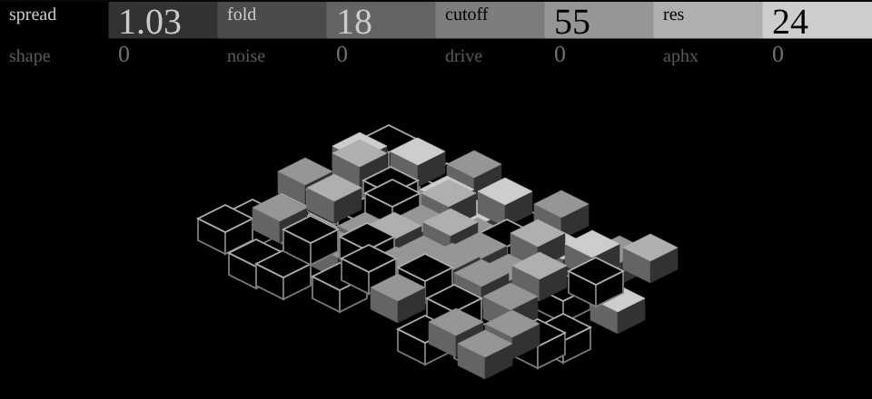
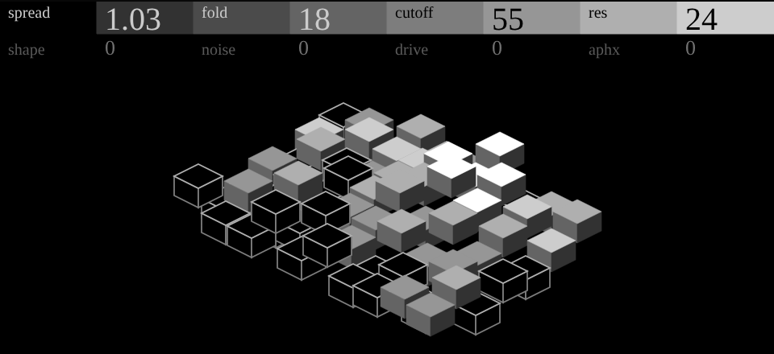
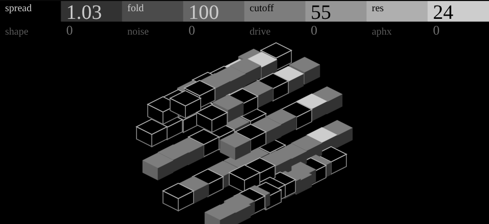
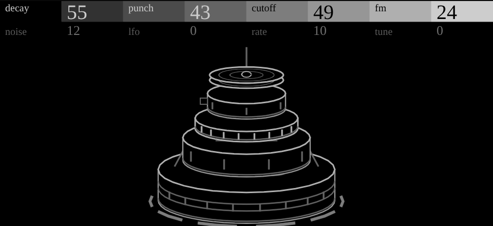
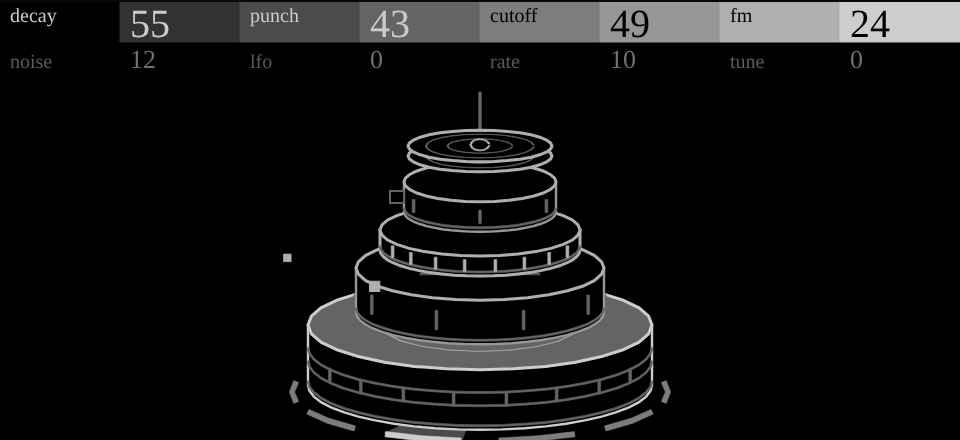
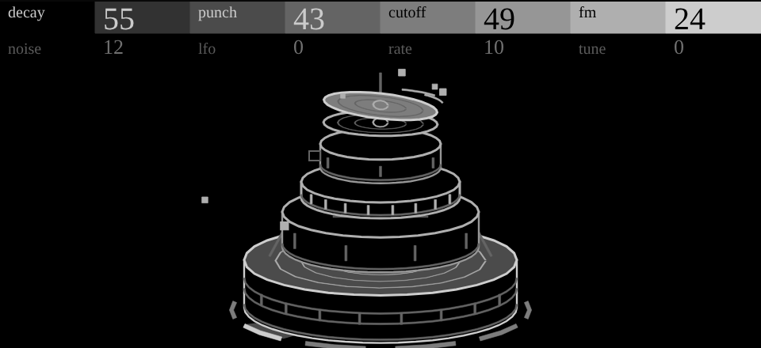
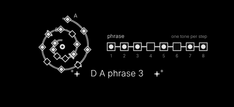

# toro and theseus for the OP-XY

This folder is my port of two of the three labyrinth plugins to the teenage engineering OP-XY, built on the [Open-XY SDK](https://github.com/etcetc000/open-xy). The OP-1 versions in the folders above are untouched; this is a separate tree with its own licence (MIT, like the SDK and most XY machines).

- **toro**: the two-oscillator wavefolder synth, with APHX. On the XY its screen is a field of stacked isometric slabs whose heights are a small model of the voice.
- **theseus**: the DFAM-style percussion voice. On the XY its screen is the kit stacked into a tower, kick to hi-hat, and the drum that's hit jumps and lights.
- **meikyu**: the shift register as a note player (phrase mode), on SDK 1.8, the release that added players. See [What about meikyu?](#what-about-meikyu).















## What changed in the port

The OP-XY and the OP-1 are different instruments, and the SDKs reflect that. The sound code moved over almost as is; the screens had to be rebuilt.

| | OP-1 (kennel) | OP-XY (Open-XY) |
|---|---|---|
| Language | C | C++11, freestanding |
| Block | 128 samples | 64 samples |
| Controls | 4 knobs, 3 second-page words | 4 encoders with up to 4 alternates, all saved: 8 slots |
| Values | 0..32767 | Q31 in, Q31 out at half scale |
| Velocity | the engine reads it | not given to engines; the XY applies it after |
| Voice memory | 32 bytes | whatever it needs |
| Screen | 320 x 160, draw any lines you like each frame | 480 x 220, retained: you author SVG parts, each frame only moves, turns, scales, recolours or hides them |
| Colour | the four encoder colours | greyscale |

### Sound

Both engines keep their integer DSP byte for byte where the block size allows. The 0..32767 control range is taken from the top 15 bits of each Q31 word, so the knob curves are the OP-1's. Envelope ramps are per 64 samples instead of 128.

**toro** gets the split it never had room for on the OP-1: Drive and Aphx are separate slots on page 2. Two things are new on the XY:

- **Aphx is split at its centre.** Centre is off. Right of centre is the OP-1's per-key drift: every key keeps its own detune, cutoff, fold and resonance offsets. Left of centre is the same drift re-rolled on every note, from the track's note count instead of the key. So locking a single sequencer step to the left side re-rolls just that step, and the same pattern still plays back the same way.
- **An accent stands in for velocity.** The XY doesn't give engines velocity, so toro steps its own accent once per note, the way theseus steps its hit LFO: a four-note cycle of strong, weak, medium, weak, locked to the sequence. An accent deepens Aphx on that note (by half when strong, a quarter when medium), so it's silent with Aphx at centre. The count lives in `Shared`, so every voice on the track follows the same cycle.

There's a new preset, Roll, to hear the per-step side.

**theseus** keeps the per-hit LFO. Its phase lives in the machine's `Shared` state so every voice steps the same LFO, as on the OP-1. The two envelope divides per block became a reciprocal (the Blackfin+ has no divide). The eighth slot is new: **Tune**, -24 to +24 semitones, which shifts which drum a note picks without changing the note. On the XY the sequencer plays fixed pitches, so this is how you move a whole pattern from toms to hats. Velocity accents are gone from the engine; the XY's own velocity path stands in.

On the XY's style guide: it says engine pages should not hold LFOs, because the XY has its own. I kept theseus's LFO anyway, because it steps once per hit, which no stock LFO can do, and it is the thing that makes a pattern breathe. If the catalog review pushes back, the LFO and Rate slots are the ones to drop.

### Screens

The OP-1 screens drew hundreds of fresh lines per frame. The XY draws authored SVG and lets code move the parts, with a budget of 256 parts (512 from SDK 1.8), 4 reshapable outlines and 16 palette entries. So each screen is a `gen_panel.py` that writes the artwork (`panel.svg.fragment`) with every moving part as a separate element around its own origin, plus the tables `display.cpp` needs (`nodes.h`), and a `display.cpp` that places them each frame.

Both screens were designed first, frame by frame and in motion, in my [operators](https://github.com/thoughtgrain/operators) repository (the OP-XY screen guidance I keep beside these ports), and then fitted to the device here. The drawing is a picture of what the controls do, not a panel of readouts:

| toro (BLOCKS) | | theseus (TOWER) | |
|---|---|---|---|
| Spread | a second, slower wave runs across the field at the oscillator ratio; the two beat into a moiré of ridges | Decay | rings spread across the struck head: more of them, lasting longer |
| Fold | heights fold back on themselves, and the field wraps round a drum, almost closed at 100 | Punch | how high the struck drum jumps; how far a hat hit rocks the cymbals |
| Cutoff | low leaves the two broad waves; high adds a fine ripple of harmonics | Cutoff | how brightly the struck head fills |
| Res | one row of tops lights, moving front to back with the setting | FM | ghost hoops thrown off the struck head (none up to 30), shimmer arcs off the hats |
| Shape | saw to triangle: the ridges go from a sharp leading edge to symmetric | Noise | sparks off the struck head, more on the high drums |
| Noise | a fixed jitter in every column | LFO | some hits jump higher than others, following the hit LFO |
| Drive | the tallest columns flatten to a plateau | Rate | the floor is the LFO's clock: one dash per hit of the cycle (32 .. 2), the current one lit |
| Aphx | each column drifts by its own amount: fixed per landing spot right of centre, re-rolled every note left of it; accented notes drift further | Tune | shifts which tier the hits land on |

Greyscale was less of a loss than I expected. The OP-1 screens already gave every control its own shape so colour was never the only cue; on the XY the shapes do all the work, with grey levels for lit against unlit.

toro's screen is a field of 70 columns, each three nodes (left face, right face, top) authored at one origin, so a column only ever slides; it never reshapes. The side faces are short slabs rather than floor-length pillars, and the columns are drawn back to front, so each slab's underside is hidden by the ones in front and the screen needs no reshapable outlines at all. Each column's height is the voice's waveform at that spot: a saw/triangle and a second wave at the Spread ratio, the harmonics Cutoff lets in, then the wavefolder, Drive's ceiling, Noise and Aphx. The quiet part of the wave is drawn hollow (black faces, a grey edge), with a fixed scatter of hollow cubes on top, so the field reads as solid and wireframe at once. A note rolls the wave forward a step, pushes a patch of six slabs up with white tops and sends a ripple across the field; all of it settles in under a second, and the idle field doesn't move. Everything per-column that the maths needs is worked out by the generator and written to `nodes.h` as Q10 tables, so `display.cpp` is integer-only; the drum Fold wraps the field round uses sinc products in Q14 so it stays exact as the bend goes to zero. 218 nodes.

theseus's screen is the kit itself. One voice plays every drum, so the tower stacks the kick, floor tom, snare, rack tom and hi-hat, each drawn as the drum it plays, in line: black shapes with grey outlines, so five overlapping drums stay apart. Only the drum that's hit moves, only upward, and only its head fills. Each tier's nodes share its head's centre, so a hit is one translation; rings scale about that centre; the hat's two cymbals each turn about their own. The floor clock is drawn once for each of the ten Rate settings (121 dashes) and only the current set shows; the lit step's slice of the floor is the one reshapable outline. That made the artwork the tight part: the SDK's preview caps `panel.svg` at 64 KiB, so the path data is written compactly at one decimal, and FM's ghost hoops are one shared set thrown off whichever drum was hit last rather than a set per drum. 232 nodes.

Two XY-specific things worth knowing, plus the device's own drawing rules:

- **The screen doesn't know the pitch.** The XY tells a display how many notes are held and counts note starts; it doesn't say which note. On the OP-1 the engine told the screen which drum zone a hit landed in. Here theseus's screen walks a 16-step stand-in groove (kick, hat, floor tom, hat, snare...) by the note count, shifts its zones by Tune exactly as the engine shifts a pitch's zone, and lights the nearest tier. The sound follows the real pitch; the drawing follows a plausible one. toro has the same gap, so its notes land on eight spots in turn rather than by key.
- **Paint comes from a palette.** A part painted "fill and stroke" takes its fill, stroke and stroke width from one palette entry, so a node's look is its shade. toro's ten entries are the face greys, the lit and flash tops, and two hollow ones (black fill, grey edge); theseus's sixteen are the shell and head outlines, five fills for a struck head, and solid greys for the ribbons that draw its lines.
- **The device is stricter than the preview.** Open-XY's PR 260 ("Drawing on the device", now folded into "Artwork" in `docs/display.md`) lists what the hardware does with artwork: every path must be one subpath of at most 64 points (compound paths stopped the device at launch), a turn within 2.5° of straight back draws a streak, points closer than 1/8 px merge, and only an authored fill is ever filled. So every figure is a **group** of single-subpath parts sharing a pivot: `gen_panel.py` assigns the node indices and writes `nodes.h`, and `display.cpp` moves a group with one call. toro is 218 nodes, theseus 232. The SDK has since added two more for authored artwork: numbers carry at most four fractional digits and no exponent, and a bound element's transform is none or `matrix(1 0 0 1 x y)`. `tools/panel_lint.py` checks all three panels against all of those rules; run it after regenerating artwork.

## Build and try

You need the Open-XY SDK checked out beside this repository, with its preview tools (Python 3.11+, NumPy 2.3.5, Node 22.12+, clang with wasm32). Then, from the SDK folder:

```sh
python sdk.py test --machine ../labyrinth/opxy/machines/toro
python sdk.py test --machine ../labyrinth/opxy/machines/theseus
python sdk.py preview --machine ../labyrinth/opxy/machines/toro --out local/toro
python tools/serve_harness.py --preview local/toro      # then open http://127.0.0.1:8917/
```

`test` runs each machine's own sound checks (`tests/sound.cpp`: the same sweeps as the OP-1 tests, ported), builds the browser preview, checks every drawing frame against the SDK's bounds, and prints a host-timed CPU estimate. To build firmware you need the pinned Blackfin+ toolchain and your own `os.ldr`; the SDK's `docs/build.md` covers that.

If you change the artwork, regenerate it: `python3 gen_panel.py` in toro's or theseus's folder (it writes `panel.svg.fragment`, `nodes.h` and the display block in `definition.json`), `python3 gen_panel.py > panel.svg.fragment` in meikyu's; then `python3 tools/panel_lint.py machines/*/panel.svg.fragment`.

## Status

| Check | Status |
|---|---|
| toro sound test (6561 control/note combinations, APHX determinism and drift) | passed |
| theseus sound test (5832 control/pad combinations, zones, LFO rate, Tune) | passed |
| `sdk.py test` on both: preview ABI, memory, peak bounds, every frame valid | passed |
| CPU estimate (host-timed, not the device) | toro about 9–11 k, theseus about 13–15 k instructions per voice block at the heaviest setting; the aim is 15 k |
| Screens in the SDK's browser workbench | checked |
| meikyu player: host test against the `firmware/native-players` branch | passed; not yet heard on hardware. Checked by reading against SDK 1.9 `main` (`2ca22e7`): API unchanged, `machine.json` moved to `"sdk": "1.8"`; not yet re-run there |
| Firmware build and the OP-XY itself | **not done**: no Blackfin+ toolchain or XY here. The catalog also needs a hardware CPU measurement (`docs/profiling.md` in the SDK) |

theseus is the one to measure first: at its heaviest setting (full FM and noise, a long decay) the estimate sits at the aim. If the device says it is over, the noise mix and the FM index are the two things to make cheaper.

## What about meikyu?

The OP-XY has no sequencer plugins. The SDK offers synths, sample engines and effects, plus "extensions" that observe firmware events, and the two events a sequencer would need (a pattern step playing, notes reaching a track) are listed as not exposed. The right home for meikyu on the XY is a **player**, the XY's own note-effect stage (arpeggio, maestro, hold).

The SDK added that in 1.8: it started as the `firmware/native-players` branch of `etcetc000/open-xy` (six hooks into the stock Maestro object, a `<opxy/player.hpp>` API) and is on `main` now with a Chords player as the example in `open-xy-core-machines`. A player answers key presses with a plan of up to eight timed tones; it has no clock and can't sound a note on its own. So `machines/meikyu/` is meikyu as a **phrase player**: every note, live or sequenced, plays the next eight steps of the self-corrupting register, rooted on that note, and the pattern drifts across the bar. Its [README](machines/meikyu/README.md) has the controls and what's missing against the OP-1. It passed the branch's `sdk.py test` on the host, and the merged API is the same one it was written against; it's waiting on a firmware build to be heard.

## Licence

MIT, see `LICENSE` in this folder. The OP-1 plugins in the folders above stay GPL-3.0-or-later with the OP-1 firmware permission; this tree is a separate work that shares their design and DSP, which I own.
