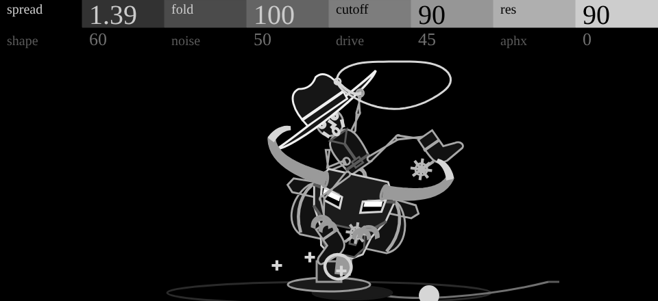
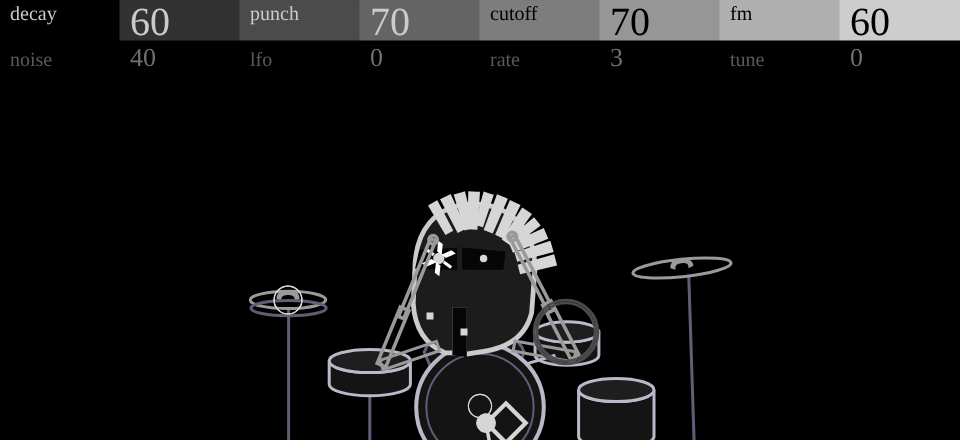

# toro and theseus for the OP-XY

This folder is my port of two of the three labyrinth plugins to the teenage engineering OP-XY, built on the [Open-XY SDK](https://github.com/etcetc000/open-xy). The OP-1 versions in the folders above are untouched; this is a separate tree with its own licence (MIT, like the SDK and most XY machines).

- **toro**: the two-oscillator wavefolder synth, with APHX.
- **theseus**: the DFAM-style percussion voice.
- **meikyu** is not here yet. See [What about meikyu?](#what-about-meikyu) for why, and what the plan is.





## What changed in the port

The OP-XY and the OP-1 are different instruments, and the SDKs reflect that. The sound code moved over almost as is; the screens had to be rebuilt.

| | OP-1 (kennel) | OP-XY (Open-XY) |
|---|---|---|
| Language | C | C++11, freestanding |
| Block | 128 samples | 64 samples |
| Controls | 4 knobs, 3 second-page words | 4 encoders with up to 4 alternates, all saved: 8 slots |
| Values | 0..32767 | Q31 in, Q31 out at half scale |
| Velocity | the engine reads it | not given to engines; the XY applies it after |
| Voice memory | 32 bytes | whatever it needs |
| Screen | 320 x 160, draw any lines you like each frame | 480 x 220, retained: you author SVG parts, each frame only moves, turns, scales, recolours or hides them |
| Colour | the four encoder colours | greyscale |

### Sound

Both engines keep their integer DSP byte for byte where the block size allows. The 0..32767 control range is taken from the top 15 bits of each Q31 word, so the knob curves are the OP-1's. Envelope ramps are per 64 samples instead of 128.

**toro** gets the split it never had room for on the OP-1: Drive and Aphx are separate slots on page 2. Velocity is gone from the engine, so APHX's accent-deepening is gone with it (the XY's velocity reaches the track level instead).

**theseus** keeps the per-hit LFO. Its phase lives in the machine's `Shared` state so every voice steps the same LFO, as on the OP-1. The two envelope divides per block became a reciprocal (the Blackfin+ has no divide). The eighth slot is new: **Tune**, -24 to +24 semitones, which shifts which drum a note picks without changing the note. On the XY the sequencer plays fixed pitches, so this is how you move a whole pattern from toms to hats. Velocity accents are gone from the engine; the XY's own velocity path stands in.

On the XY's style guide: it says engine pages should not hold LFOs, because the XY has its own. I kept theseus's LFO anyway, because it steps once per hit, which no stock LFO can do, and it is the thing that makes a pattern breathe. If the catalog review pushes back, the LFO and Rate slots are the ones to drop.

### Screens

The OP-1 screens drew hundreds of fresh lines per frame. The XY draws authored SVG and lets code move the parts, with a budget of 256 parts, 4 reshapable outlines and 16 greys. So each screen is now a `gen_panel.py` that writes the artwork (`panel.svg.fragment`) with every moving part as a separate element around its own pivot, and a `display.cpp` that places them. The composition and the per-control shapes are the OP-1's:

| toro | | theseus | |
|---|---|---|---|
| Spread | the horns spread; the hat brim with them | Decay | ripple rings from the struck head |
| Fold | the rig rocks, the cowboy is thrown, his legs kick, a pulse runs the hose | Punch | the kick beater winds back; a diamond on impact |
| Cutoff | the eye slits open; a glow on notes | Cutoff | the eyes burn; rays on strong hits |
| Res | the nose ring swings; the lasso rises and spins | FM | the crest grows, goes jagged and shakes |
| Shape | the horn tips curl | Noise | sizzle specks |
| Noise | sparks off the turntable | LFO | the head slides, with motion arcs |
| Drive | steam from the vents | Rate | how fast it slides |
| Aphx | glitch slices tear across the rig | Tune | moves which drum the sticks land on |

Greyscale was less of a loss than I expected. The OP-1 screens already gave every control its own shape so colour was never the only cue; on the XY the shapes do all the work, with grey levels for lit against unlit.

Two XY-specific things worth knowing:

- **The screen doesn't know the pitch.** The XY tells a display how many notes are held and counts note starts; it doesn't say which note. On the OP-1 the engine told the screen which drum zone a hit landed in. Here theseus's screen walks a stand-in pattern (kick-heavy, like a DRM pattern, seeded by the note count) to decide which drum the sticks hit. The sound follows the real pitch; the drawing follows a plausible one. The head still turns toward the drum it draws.
- **Paint comes from a palette.** A part painted "fill and stroke" takes both from one palette entry, so I built the palette in two halves: entries 0..7 are a near-black fill with an outline from dim to white (bodies), 8..15 are solid greys (lit parts).

## Build and try

You need the Open-XY SDK checked out beside this repository, with its preview tools (Python 3.11+, NumPy 2.3.5, Node 22.12+, clang with wasm32). Then, from the SDK folder:

```sh
python sdk.py test --machine ../labyrinth/opxy/machines/toro
python sdk.py test --machine ../labyrinth/opxy/machines/theseus
python sdk.py preview --machine ../labyrinth/opxy/machines/toro --out local/toro
python tools/serve_harness.py --preview local/toro      # then open http://127.0.0.1:8917/
```

`test` runs each machine's own sound checks (`tests/sound.cpp`: the same sweeps as the OP-1 tests, ported), builds the browser preview, checks every drawing frame against the SDK's bounds, and prints a host-timed CPU estimate. To build firmware you need the pinned Blackfin+ toolchain and your own `os.ldr`; the SDK's `docs/build.md` covers that.

If you change the artwork, regenerate it: `python3 gen_panel.py > panel.svg.fragment` in the machine's folder.

## Status

| Check | Status |
|---|---|
| toro sound test (6561 control/note combinations, APHX determinism and drift) | passed |
| theseus sound test (5832 control/pad combinations, zones, LFO rate, Tune) | passed |
| `sdk.py test` on both: preview ABI, memory, peak bounds, every frame valid | passed |
| CPU estimate (host-timed, not the device) | toro about 9–11 k, theseus about 13–15 k instructions per voice block at the heaviest setting; the aim is 15 k |
| Screens in the SDK's browser workbench | checked |
| Firmware build and the OP-XY itself | **not done**: no Blackfin+ toolchain or XY here. The catalog also needs a hardware CPU measurement (`docs/profiling.md` in the SDK) |

theseus is the one to measure first: at its heaviest setting (full FM and noise, a long decay) the estimate sits at the aim. If the device says it is over, the noise mix and the FM index are the two things to make cheaper.

## What about meikyu?

The OP-XY has no sequencer plugins. The SDK offers synths, sample engines and effects, plus "extensions" that observe firmware events, and the two events a sequencer would need (a pattern step playing, notes reaching a track) are listed as not exposed. The right home for meikyu on the XY is a **player**, the XY's own note-effect stage (arpeggio, maestro, hold), which the SDK doesn't support yet. Adding that means mapping the stock players in the firmware and adding a player type to the SDK, which needs the firmware file from a device and hardware to test on. That is the next step, separate from this port.

## Licence

MIT, see `LICENSE` in this folder. The OP-1 plugins in the folders above stay GPL-3.0-or-later with the OP-1 firmware permission; this tree is a separate work that shares their design and DSP, which I own.
